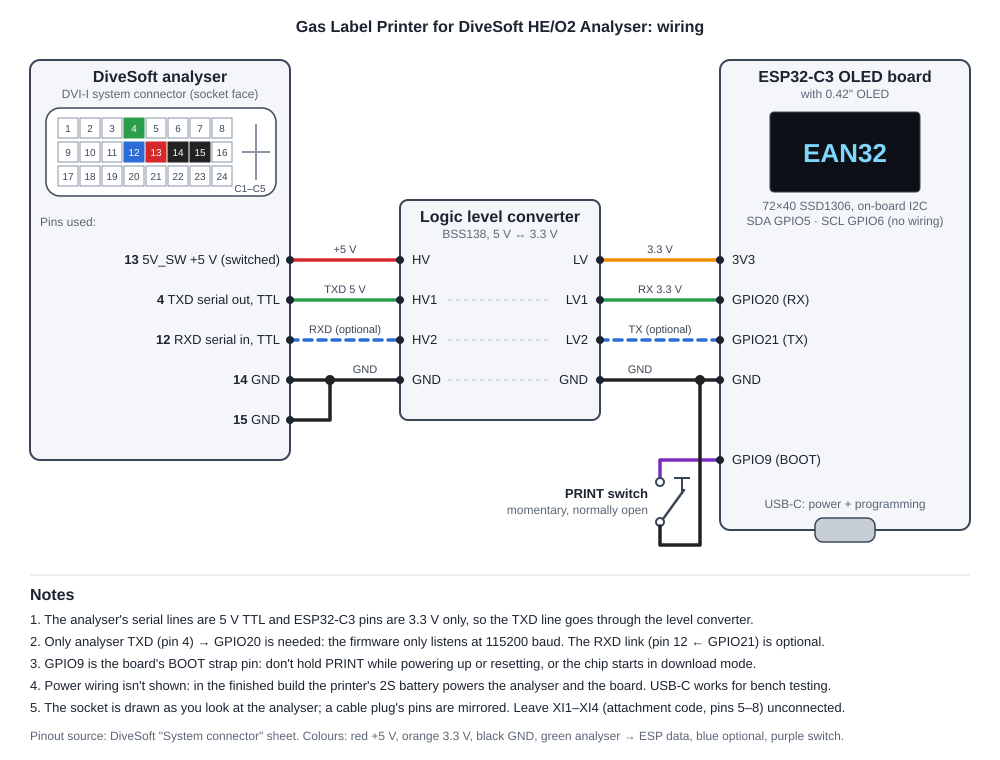

# Gas Label Printer for DiveSoft HE/O2 Analyser

ESP32-C3 firmware that listens to the serial output of a DiveSoft helium/oxygen analyser and prints a gas label for the cylinder on a Bluetooth (BLE) thermal label printer at the press of a button.

Project page: https://deepfocusau.github.io/Gas-Label-Printer-for-DiveSoft-HE-O2-Analyser/

## What it does

- Reads each analyser line over UART (115200 baud, 8N1), for example
  `He 35.0 % O2 21.0 % Ti 22.4 ~C 2026-08-25 06:54:00`
- Snaps the reading to the nearest standard mix (Oxygen, Air, EAN32–EAN80, 10/70, 15/55, 18/45, 21/35, 10/50); otherwise it shows the measured O2/He.
- Works out the MOD at a ppO2 of 1.6, and never prints a MOD deeper than the measured O2 allows.
- Shows the gas name on a small OLED, with status screens: `PAIR` (no printer), `NO SIG` (analyser silent), `WAIT`, `PRNT`, `ERR`.
- On a button press, prints a 48 mm label with four lines: gas name, MOD, measured O2/He, and the analyser's date and time.
- Will not print a stale reading: if no valid line arrives for 5 seconds, the reading is cleared.

## Hardware

| Part | Notes |
| --- | --- |
| ESP32-C3 with 72×40 SSD1306 OLED | Board profile `esp32-c3-devkitm-1`; OLED on I2C SDA GPIO5 / SCL GPIO6 |
| Print button | Momentary switch, GPIO9 to GND (internal pull-up). GPIO9 is the BOOT strap: don't hold it during power-up. |
| Logic level converter | BSS138, 5 V ↔ 3.3 V. The analyser's serial lines are 5 V TTL. |
| Analyser serial | DVI-I pin 4 (TXD) → converter → GPIO20 (RX). Pin 12 (RXD) ← GPIO21 is optional. |
| BLE thermal label printer | 384 dots wide (48 mm). Developed with a DP230S printer. |

## Wiring



Analyser DVI-I system connector, pins used: 4 TXD, 12 RXD (optional), 13 5V_SW (powers the converter's HV side), 14/15 GND. The ESP32-C3 is powered from USB-C.

## Building

The project uses [PlatformIO](https://platformio.org/).

```bash
pio run -t upload
pio device monitor
```

Libraries (installed by PlatformIO): U8g2, NimBLE-Arduino 1.4, Adafruit GFX.

## Configuration

In `src/main.cpp`:

- `ThermalPrinterBLE printer("DP230S-...")`: set this to your printer's Bluetooth name.
- `DEBUG_MODE`: set to `true` to cycle through the standard gases without an analyser attached.
- `SERIAL_DIAG`: echoes every analyser line to the USB serial monitor.
- `standardMixes[]`: the list of standard gases and their MODs.

## Disclaimer

This is a hobby project and is not affiliated with DiveSoft. Always analyse and label your gas yourself and confirm the label before diving.
