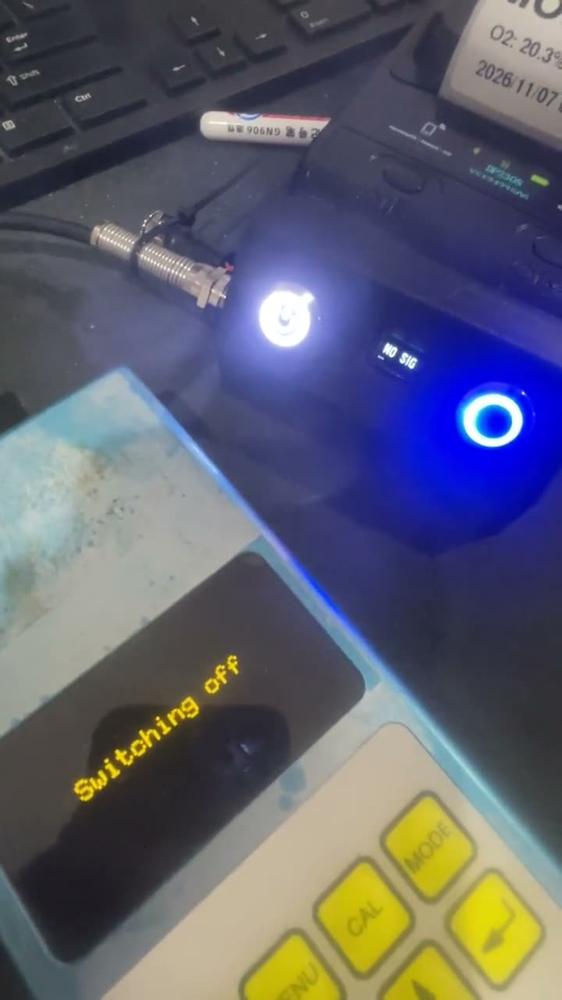
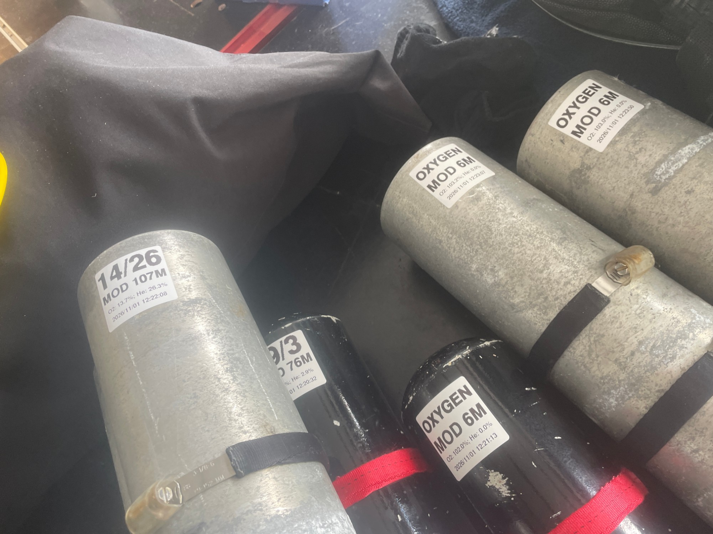
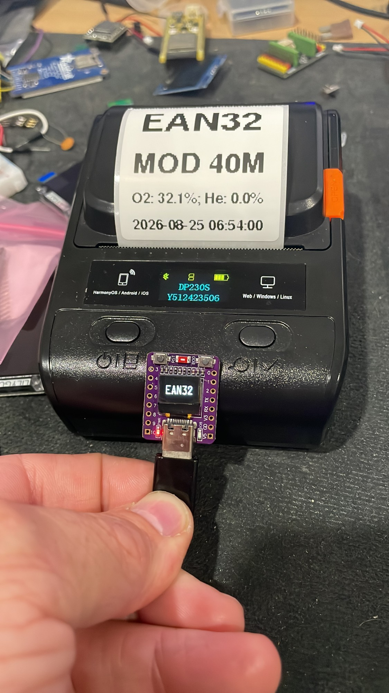
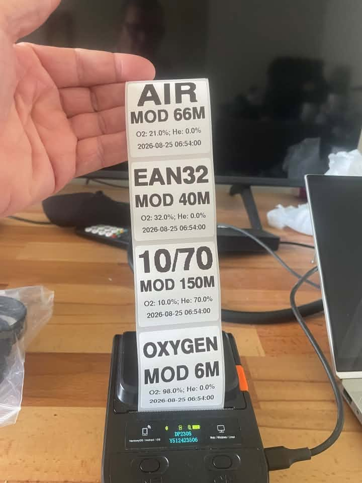
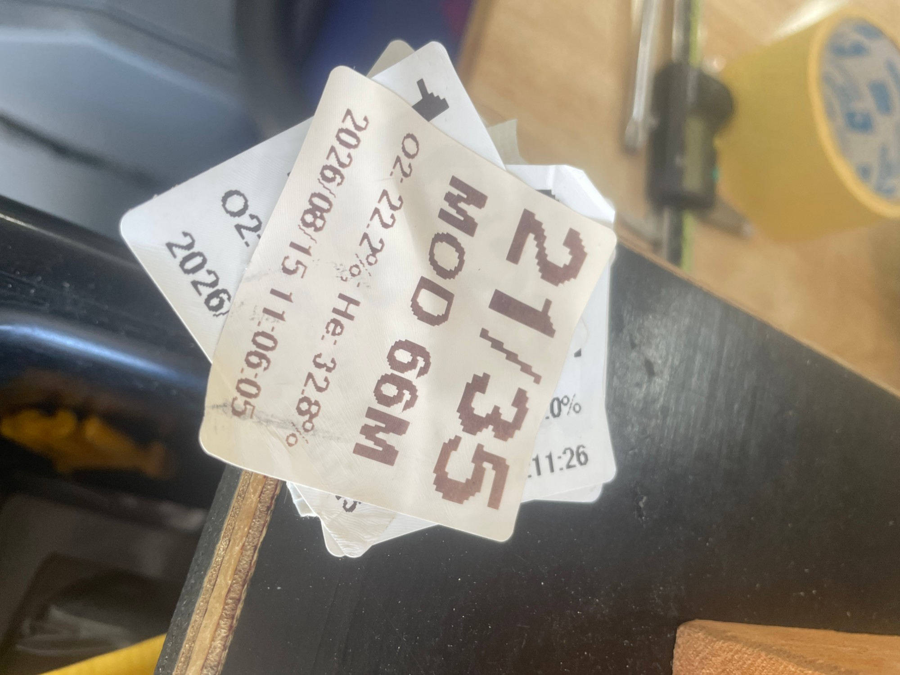
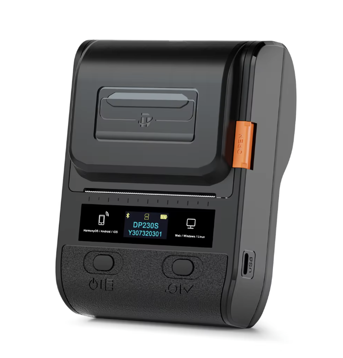

# Gas Label Printer for DiveSoft HE/O2 Analyser

ESP32-C3 firmware that listens to the serial output of a DiveSoft helium/oxygen analyser and prints a gas label for the cylinder on a Bluetooth (BLE) thermal label printer at the press of a button.

Project page: https://deepfocusau.github.io/Gas-Label-Printer-for-DiveSoft-HE-O2-Analyser/

## Background

I built this for my Divesoft He/O2 analyser, which is about 20 years old. Credit to Divesoft for an analyser that has lasted this long, for giving it an open serial interface, and for excellent factory support to this day.

It prints a single hybrid label with both the gas analysis and the MOD. That won't suit everyone, but it's what I wanted.

## See it work

[](docs/images/demo.mp4)

Click the picture for the video: connecting the analyser, switching on, reading the gas and printing the label (49 s, no sound). It also plays on the [project page](https://deepfocusau.github.io/Gas-Label-Printer-for-DiveSoft-HE-O2-Analyser/).

## What it does

- No app and no Wi-Fi: press the button and the label prints.
- The printer's rechargeable 2S lithium battery also powers the analyser (originally a 9 V unit) and the ESP32 board.
- Reads each analyser line over UART (115200 baud, 8N1), for example
  `He 35.0 % O2 21.0 % Ti 22.4 ~C 2026-08-25 06:54:00`
- A reading within ±2% O2 and ±5% He of a standard gas locks on to it, for an easy-to-read label (Oxygen, Air, EAN32–EAN80, 10/70, 15/55, 18/45, 21/35, 10/50). Anything else prints as measured O2/He.
- Works out the MOD at a ppO2 of 1.6, and never prints a MOD deeper than the measured O2 allows.
- Shows the gas name on a small OLED, with status screens: `PAIR` (no printer), `NO SIG` (analyser silent), `WAIT`, `PRNT`, `ERR`.
- On a button press, prints a 50 × 50 mm label with four lines: gas name, MOD, measured O2/He, and the date and time from the analyser's own clock.
- Will not print a stale reading: if no valid line arrives for 5 seconds, the reading is cleared.

## Photos

Labels in use on stage and deco cylinders:



The ESP32-C3 board showing EAN32 on its OLED, beside the label it just printed on the Detonger DP230S:



A strip of labels for four standard gases (50 × 50 mm):



Early labels, printed before the text rendering was smoothed: the large text was scaled up in whole-pixel blocks and came out stair-stepped.



## Printer and labels



| Spec | Detonger DP230S, as used here |
| --- | --- |
| Type | Portable direct-thermal label printer (no ink or ribbon) |
| Print width | 384 dots, 48 mm (8 dots/mm, 203 dpi) |
| Connection to this project | Bluetooth Low Energy; found by its Bluetooth name (`DP230S-<serial>`) |
| Commands | ESC/POS raster bitmap (`GS v 0`), with `GS FF` to feed to the next label gap |
| Other ports | USB-C |
| Display | Small OLED: model, serial, Bluetooth and battery status |
| Labels | Low-cost 50 × 50 mm waterproof direct-thermal gap labels |
| How the labels last | Hold up well and peel off cleanly months later, with little or no residue. Fine inside a car, but they fade under strong UV. |

## Hardware

| Part | Notes |
| --- | --- |
| [ESP32-C3 OLED board with 0.42" OLED](https://www.aliexpress.com/item/1005007892774677.html) (72×40 SSD1306) | Board profile `esp32-c3-devkitm-1`; OLED on I2C SDA GPIO5 / SCL GPIO6 |
| Print button | Momentary switch, GPIO9 to GND (internal pull-up). GPIO9 is the BOOT strap: don't hold it during power-up. |
| Logic level converter | BSS138, 5 V ↔ 3.3 V. The analyser's serial lines are 5 V TTL. |
| Analyser serial | DVI-I pin 4 (TXD) → converter → GPIO20 (RX). Pin 12 (RXD) ← GPIO21 is optional. |
| Detonger DP230S Bluetooth thermal label printer | Connects over BLE by its Bluetooth name. 384-dot (48 mm) print width. |
| Labels | 50 × 50 mm thermal labels |

## Wiring


Analyser DVI-I system connector, pins used: 4 TXD, 12 RXD (optional), 13 5V_SW (powers the converter's HV side), 14/15 GND. The diagram shows the signal wiring; in the finished build, the printer's battery powers the analyser and the board.

## Building

The project uses [PlatformIO](https://platformio.org/).

```bash
pio run -t upload
pio device monitor
```

Libraries (installed by PlatformIO): U8g2, NimBLE-Arduino 1.4, Adafruit GFX.

## Configuration

In `src/main.cpp`:

- `ThermalPrinterBLE printer("DP230S-...")`: set this to your printer's Bluetooth name.
- `DEBUG_MODE`: set to `true` to cycle through the standard gases without an analyser attached.
- `SERIAL_DIAG`: echoes every analyser line to the USB serial monitor.
- `standardMixes[]`: the list of standard gases and their MODs.

## 3D-printed parts

Fusion 360 sources and printable STLs are in [`hardware/enclosure`](hardware/enclosure). GitHub shows the STL files in a 3D viewer.

| Part | STL | Fusion 360 source |
| --- | --- | --- |
| Dongle | [Dongle.stl](hardware/enclosure/Dongle.stl) | [DiveSoft-Program-Dongle.f3d](hardware/enclosure/DiveSoft-Program-Dongle.f3d) |
| Cradle | [Cradle.stl](hardware/enclosure/Cradle.stl) | [DiveSoft-PrinterDisplay.f3d](hardware/enclosure/DiveSoft-PrinterDisplay.f3d) |

## Ideas for improvement

- **Wireless link from the analyser to the printer.** I wired it because I wanted to power the analyser from the printer, but for newer analysers a wireless dongle makes more sense.
- **A second print button** for an alternative label, such as MOD only or gas analysis only.
- **Switching on and off with the analyser**, instead of separately.
- **Bluetooth pairing from the device.** The printer's name is currently hard-coded.
- **A better cradle** that houses the electronics and combines them with the printer.

## Disclaimer

This is a hobby project and is not affiliated with DiveSoft. Always analyse and label your gas yourself and confirm the label before diving.
