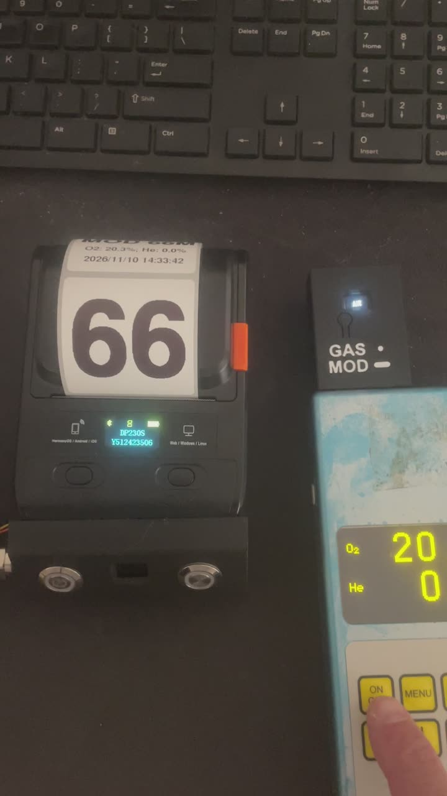
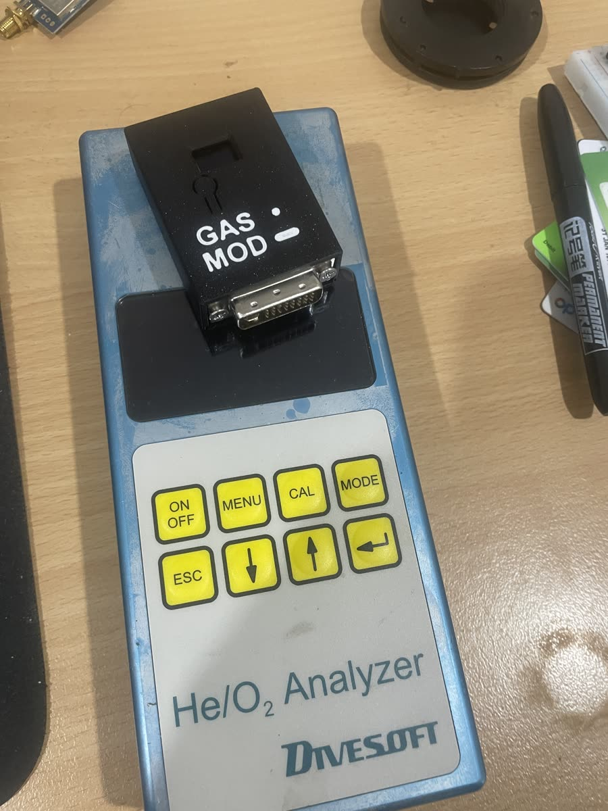
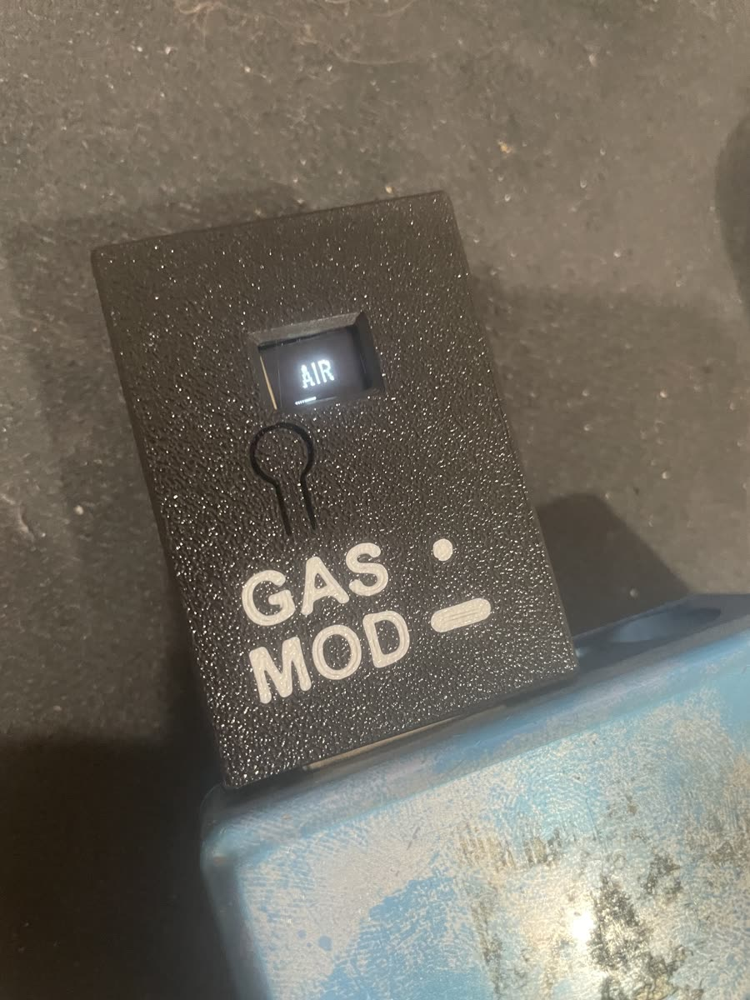
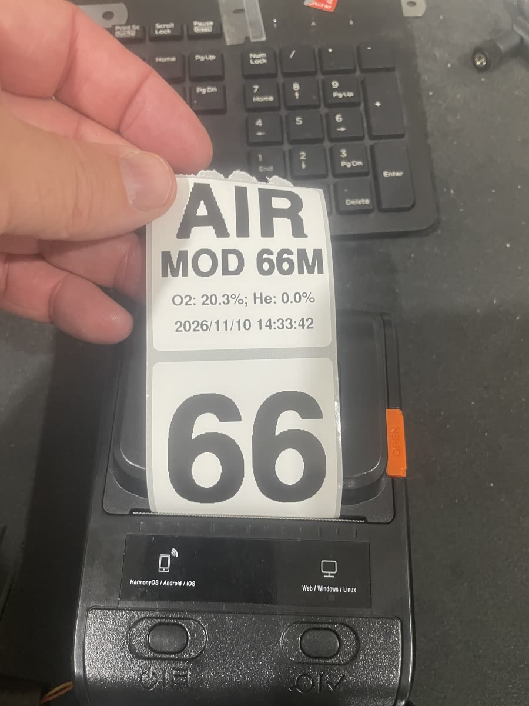
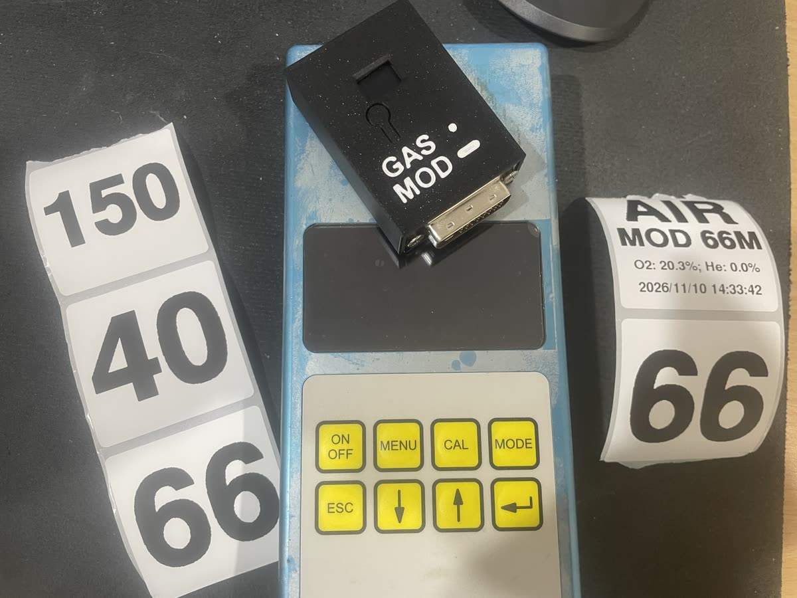
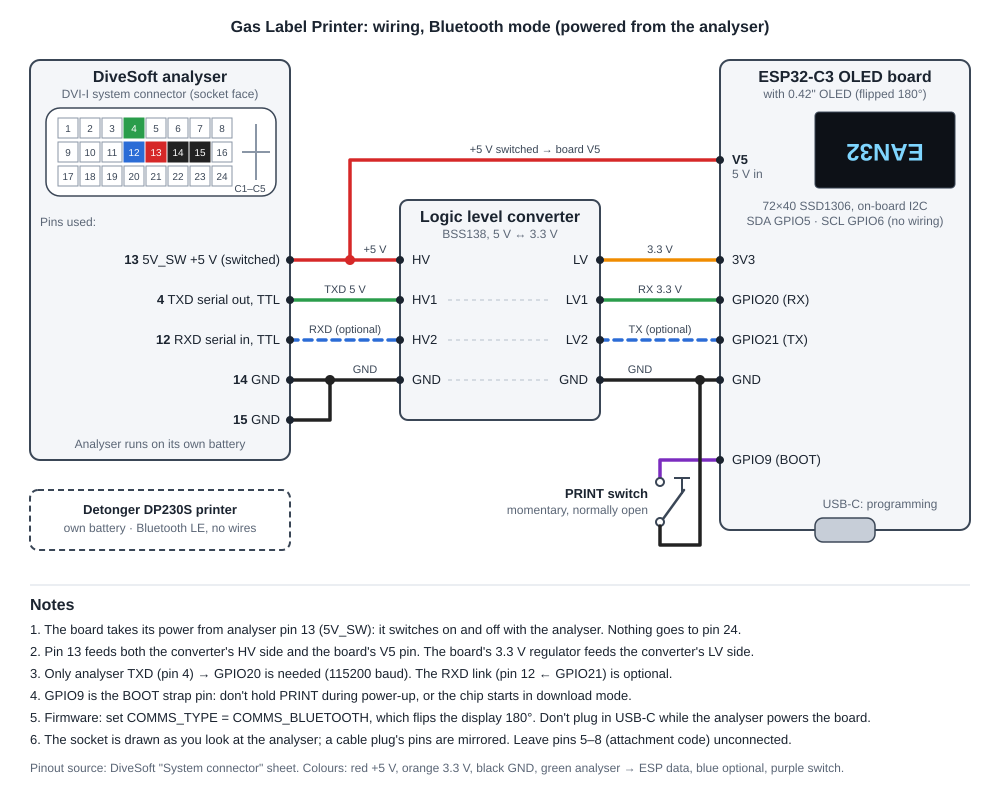

# Gas Label Printer for DiveSoft HE/O2 Analyser

ESP32-C3 firmware that listens to the serial output of a DiveSoft helium/oxygen analyser and prints a gas label for the cylinder on a Bluetooth (BLE) thermal label printer at the press of a button.

Project page: https://deepfocusau.github.io/Gas-Label-Printer-for-DiveSoft-HE-O2-Analyser/

## Background

I built this for my Divesoft He/O2 analyser, which is about 20 years old. Credit to Divesoft for an analyser that has lasted this long, for giving it an open serial interface, and for excellent factory support to this day.

It prints a single hybrid label with both the gas analysis and the MOD. That won't suit everyone, but it's what I wanted.

## See it work

[](docs/images/demo.mp4)

Wired version: connecting the analyser, switching on, reading the gas and printing the label (49 s, no sound).

[](docs/images/demo-bluetooth.mp4)

Bluetooth version: a short press on the dongle prints the gas label, and a 1 s hold prints the MOD label (28 s).

Click a picture to watch. Both videos also play on the [project page](https://deepfocusau.github.io/Gas-Label-Printer-for-DiveSoft-HE-O2-Analyser/).

## What it does

- No app and no Wi-Fi: press the button and the label prints.
- The printer's rechargeable 2S lithium battery also powers the analyser (originally a 9 V unit) and the ESP32 board.
- Reads each analyser line over UART (115200 baud, 8N1), for example
  `He 35.0 % O2 21.0 % Ti 22.4 ~C 2026-08-25 06:54:00`
- A reading within ±2% O2 and ±5% He of a standard gas locks on to it, for an easy-to-read label (Oxygen, Air, EAN32–EAN80, 10/70, 15/55, 18/45, 21/35, 10/50). Anything else prints as measured O2/He.
- Works out the MOD at a ppO2 of 1.6, and never prints a MOD deeper than the measured O2 allows.
- Shows the gas name on a small OLED, with status screens: `PAIR` (no printer), `NO SIG` (analyser silent), `WAIT`, `PRNT`, `ERR`.
- On a button press, prints a 50 × 50 mm label with four lines: gas name, MOD, measured O2/He, and the date and time from the analyser's own clock.
- Will not print a stale reading: if no valid line arrives for 5 seconds, the reading is cleared.

## Photos

Labels in use on stage and deco cylinders:


The ESP32-C3 board showing EAN32 on its OLED, beside the label it just printed on the Detonger DP230S:


Bluetooth version: the dongle plugs straight into the analyser's system connector. Its OLED shows the gas, and the tab below it is the print button (GAS: short press, MOD: hold).

 

The gas label and the MOD label printed from the same reading:

 

A strip of labels for four standard gases (50 × 50 mm):


Early labels, printed before the text rendering was smoothed: the large text was scaled up in whole-pixel blocks and came out stair-stepped.


## Printer and labels


| Spec | Detonger DP230S, as used here |
| --- | --- |
| Type | Portable direct-thermal label printer (no ink or ribbon) |
| Print width | 384 dots, 48 mm (8 dots/mm, 203 dpi) |
| Connection to this project | Bluetooth Low Energy; found by its Bluetooth name (`DP230S-<serial>`) |
| Commands | ESC/POS raster bitmap (`GS v 0`), with `GS FF` to feed to the next label gap |
| Other ports | USB-C |
| Display | Small OLED: model, serial, Bluetooth and battery status |
| Labels | Low-cost 50 × 50 mm waterproof direct-thermal gap labels |
| How the labels last | Hold up well and peel off cleanly months later, with little or no residue. Fine inside a car, but they fade under strong UV. |

## Build parts list

There are two versions. Pick one, then set `COMMS_TYPE` in `src/main.cpp` to match.

### Wired version

The printer's battery powers the analyser and the board, through a cable between the dongle on the analyser and the cradle that holds the printer. Firmware: `COMMS_TYPE = COMMS_HARDWIRED`. Wiring: [docs/wiring.svg](docs/wiring.svg).

| Qty | Part | Notes |
| --- | --- | --- |
| 1 | [ESP32-C3 OLED board with 0.42" OLED](https://www.aliexpress.com/item/1005007892774677.html) | ESP32-C3 Super Mini with a 72×40 SSD1306 OLED on board |
| 1 | Logic level converter, BSS138, 4-channel, 5 V ↔ 3.3 V | One channel needed, two with the optional RXD link |
| 1 | Momentary push button, normally open | The print button, GPIO9 to GND |
| 1 | DVI-I plug (24+5) | Mates with the analyser's system connector socket |
| 1 | 9 V boost converter | 2S Li-ion (7.4 V nominal) in, 9 V out to DVI pin 24 |
| 1 | 5 V step-down (buck) converter | 2S Li-ion in, 5 V out to the board's V5 pin |
| 1 | Multi-core cable | Dongle to cradle; at least 4 cores (9 V, 5 V, GND, serial), 5 with the optional RXD link |
| 2 | SM12 cable glands | One at each end of the cable |
| 1 | Dongle, 3D-printed | [Dongle.stl](hardware/enclosure/Dongle.stl) |
| 1 | Cradle, 3D-printed | [Cradle.stl](hardware/enclosure/Cradle.stl); holds the printer and the electronics |
| 1 | Detonger DP230S Bluetooth thermal label printer | Its internal 2S battery also powers the analyser and the board |
| 1 roll | 50 × 50 mm direct-thermal gap labels | |
| — | Hook-up wire | |

### Bluetooth version

The board sits in the dongle on the analyser and runs off the analyser's own battery, from DVI pin 13 (5V_SW), so it switches on and off with the analyser. The printer stands alone on its own battery and connects over Bluetooth, with no cable. Firmware: `COMMS_TYPE = COMMS_BLUETOOTH`. Wiring: [docs/wiring-wireless.svg](docs/wiring-wireless.svg).

| Qty | Part | Notes |
| --- | --- | --- |
| 1 | [ESP32-C3 OLED board with 0.42" OLED](https://www.aliexpress.com/item/1005007892774677.html) | ESP32-C3 Super Mini with a 72×40 SSD1306 OLED on board; the display is flipped 180° in this version |
| 1 | Logic level converter, BSS138, 4-channel, 5 V ↔ 3.3 V | One channel needed, two with the optional RXD link |
| 1 | DVI-I plug (24+5) | Mates with the analyser's system connector socket |
| 1 | Dongle, 3D-printed | Houses the board, converter and plug, with a window for the OLED and a flexible tab that presses the board's BOOT button |
| 1 | Detonger DP230S Bluetooth thermal label printer | Unmodified, on its own battery |
| 1 roll | 50 × 50 mm direct-thermal gap labels | |
| — | Hook-up wire | |

The print button is the board's own BOOT button, pressed through the dongle's flexible tab: a short press prints the gas label and a 1 s hold prints a MOD label. So this version needs no separate button, converters, cable, glands or cradle. Neither list includes printing filament, screws or heat-shrink.

## Hardware

| Part | Notes |
| --- | --- |
| [ESP32-C3 OLED board with 0.42" OLED](https://www.aliexpress.com/item/1005007892774677.html) (72×40 SSD1306) | Board profile `esp32-c3-devkitm-1`; OLED on I2C SDA GPIO5 / SCL GPIO6 |
| Print button | Momentary switch, GPIO9 to GND (internal pull-up). GPIO9 is the BOOT strap: don't hold it during power-up. |
| Logic level converter | BSS138, 5 V ↔ 3.3 V. The analyser's serial lines are 5 V TTL. |
| Analyser serial | DVI-I pin 4 (TXD) → converter → GPIO20 (RX). Pin 12 (RXD) ← GPIO21 is optional. |
| Power | 9 V boost converter (to DVI pin 24) and 5 V step-down (to the board's V5 pin), both fed from the printer's 2S Li-ion battery |
| Cable | Dongle to cradle, through SM12 cable glands |
| Detonger DP230S Bluetooth thermal label printer | Connects over BLE by its Bluetooth name. 384-dot (48 mm) print width. |
| Labels | 50 × 50 mm thermal labels |

## Wiring


Analyser DVI-I system connector, pins used: 4 TXD, 12 RXD (optional), 13 5V_SW (powers the converter's HV side), 14/15 GND, and 24 (external 9 V power in). Power comes from the printer's internal 2S Li-ion battery: a 9 V boost converter feeds the analyser on pin 24, and a 5 V step-down feeds the ESP32 board's V5 pin. The cable between the dongle and the cradle runs through SM12 cable glands.

### Bluetooth mode (powered from the analyser)



The analyser runs on its own battery and the printer connects over BLE. The board takes its 5 V from DVI pin 13 (5V_SW), which also feeds the level converter's HV side, so the board switches on and off with the analyser. Pin 24 is not used. Set `COMMS_TYPE = COMMS_BLUETOOTH`.

In this mode a short press of the print (BOOT) button prints the normal gas label, and holding it for 1 s (`MOD_LABEL_HOLD_MS`) prints a MOD label instead: just the maximum operating depth in metres, the same number as on the gas label's second row, as large as it will fit. The OLED shows `MOD` when the hold has registered, so you can let go.

## Building

The project uses [PlatformIO](https://platformio.org/).

```bash
pio run -t upload
pio device monitor
```

Libraries (installed by PlatformIO): U8g2, NimBLE-Arduino 1.4, Adafruit GFX.

## Configuration

In `src/main.cpp`:

- `ThermalPrinterBLE printer("DP230S-...")`: set this to your printer's Bluetooth name.
- `DEBUG_MODE`: set to `true` to cycle through the standard gases without an analyser attached.
- `SERIAL_DIAG`: echoes every analyser line to the USB serial monitor.
- `standardMixes[]`: the list of standard gases and their MODs.
- `AUTO_OFF_MS`: after this long with no analyser reading and no button press (default 5 minutes), the board shows `OFF`, stops Bluetooth, turns the OLED off and sleeps until the print button is pressed. Set to 0 to disable.
- `POWER_EN_PIN`: optional output held high while running and low when powered down, for example to switch a 9 V boost converter with an enable pin. `-1` when not fitted.
- `CPU_FREQ_MHZ`: 80 MHz by default, to save power.

In `src/ThermalPrinterBLE.h`:

- `BLE_TX_POWER`: −12 dBm by default, since the printer is close by. Raise it if the link is unreliable.
- The printer's address is saved in flash after the first connection, so the board reconnects straight away at power-up and scans passively after that. After the link drops it scans continuously for two minutes, so the printer is picked up as soon as it advertises again, then backs off to a 1 s scan every 5 s; a button press goes back to continuous scanning.

## 3D-printed parts

Fusion 360 sources and printable STLs are in [`hardware/enclosure`](hardware/enclosure). GitHub shows the STL files in a 3D viewer.

| Part | STL | Fusion 360 source |
| --- | --- | --- |
| Dongle | [Dongle.stl](hardware/enclosure/Dongle.stl) | [DiveSoft-Program-Dongle.f3d](hardware/enclosure/DiveSoft-Program-Dongle.f3d) |
| Cradle | [Cradle.stl](hardware/enclosure/Cradle.stl) | [DiveSoft-PrinterDisplay.f3d](hardware/enclosure/DiveSoft-PrinterDisplay.f3d) |

## Done since the first version

- **Wireless link from the analyser to the printer:** the Bluetooth version, with the board in a dongle on the analyser.
- **An alternative label:** hold the print button for 1 s to print a MOD-only label. This uses the same button rather than a second one.
- **Switching on and off with the analyser:** the Bluetooth version runs from the analyser's switched 5 V. Both versions also power down after 5 minutes idle.
- **Faster reconnection:** the printer's address is remembered after the first connection.

## Ideas for improvement

- **Bluetooth pairing from the device.** The printer's name is still set in the code.
- **A better cradle** that houses the electronics and combines them with the printer.

## Disclaimer

This is a hobby project and is not affiliated with DiveSoft. Always analyse and label your gas yourself and confirm the label before diving.
